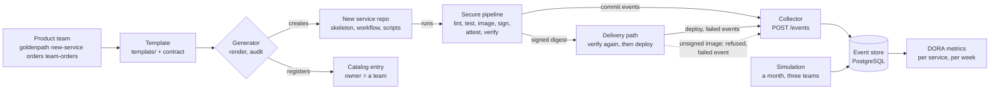

# Architecture: a golden path and the DORA metrics computed from its events

This document describes what the code in this repository does and why it is shaped this way. Component names match the diagram in the lesson ("The golden path you build"): **Product team**, **Template**, **New service repo**, **Catalog entry**, **Secure pipeline**, **Delivery path**, **Event store** and **DORA metrics**.

## Components and what each owns

| Component | Where it lives | What it owns |
| --- | --- | --- |
| **Template** | [`template/`](template), contract in [`docs/golden-path-contract.md`](docs/golden-path-contract.md) | The skeleton of every service: a small service, a Dockerfile, a Makefile (one target per pipeline step), `.github/workflows/ci.yml`, deploy and event scripts, `protection.json`, `catalog-info.yaml`. Placeholders (`__NAME__`, `__OWNER__`, `__RUNBOOK__`, `__PLATFORM_REF__`) are the only things a team supplies. |
| **Generator** | use case [`application/generate_service.py`](src/goldenpath/application/generate_service.py), `goldenpath new-service` | One command: validate the owner, render the template, **audit the result against the contract**, register the catalog entry, publish the repository. Nothing is published when the audit fails. |
| **New service repo** | `.local/services/<name>` and a bare remote `.local/remotes/<name>.git` (standing in for `gh repo create`) | The generated repository, created by [`infrastructure/repositories.py`](src/goldenpath/infrastructure/repositories.py). |
| **Catalog entry** | `catalog/teams.yaml` (committed), `.local/catalog/entities/<name>.yaml` (generated), rules in [`domain/catalog.py`](src/goldenpath/domain/catalog.py) | Owner, lifecycle, runbook, SLO. The owner must be a registered team, never a person. |
| **Conformance audit** | [`domain/rules.py`](src/goldenpath/domain/rules.py), [`infrastructure/auditor.py`](src/goldenpath/infrastructure/auditor.py), `goldenpath audit` | The contract as code: required checks, signing and verification, short-lived credentials, pinned actions, no stored credential in any file. Runs at generation, in `make lint`, and over every generated repository (`make audit`). |
| **Secure pipeline** | the template's `ci.yml` and Makefile; run locally by [`infrastructure/local_pipeline.py`](src/goldenpath/infrastructure/local_pipeline.py) | lint, test, build one image, push, **sign**, attach a provenance attestation, **verify**, deploy. One make target per step, so the workflow and a laptop run the same steps. |
| **Delivery path** | the template's `scripts/deploy.sh` and `deploy/compose.yaml` | Deploys a digest only after verifying its signature and attestation, and records the result. A refusal is a `failed` event with detail `signature`. |
| **Collector** | [`interfaces/collector.py`](src/goldenpath/interfaces/collector.py), `goldenpath collector` | An HTTP service in front of the store: `POST /events`, validated by the domain, deduplicated, behind a bearer token. Pipelines hold no database credential. |
| **Event store** | [`infrastructure/postgres_store.py`](src/goldenpath/infrastructure/postgres_store.py) and `sql/`; a CSV adapter for the lesson's sample | The only input of the metrics: commit, deploy, failed and recovered events with UTC timestamps. |
| **DORA metrics** | [`domain/metrics.py`](src/goldenpath/domain/metrics.py), the same numbers in SQL ([`sql/003_queries.sql`](sql/003_queries.sql)), `goldenpath metrics`, `goldenpath trace` | Deployment frequency, lead time, change fail rate and recovery time per service and per week, and a trace from any lead time to its two events. |
| **Simulation** | [`domain/simulation.py`](src/goldenpath/domain/simulation.py), `goldenpath simulate` | A deterministic month of events for three teams that work differently ([ADR 0006](docs/adr/0006-the-simulation-states-its-assumptions.md)). |

## Pattern: ports and adapters, with the contract as pure rules

The domain holds the events, the four metrics, the catalog rules, the conformance rules and the simulation, with nothing but the standard library (import-linter forbids `psycopg`, `yaml`, `subprocess`, `http` and `urllib` in `domain` and `application`). The application layer has the use cases (record events, measure, generate a service) and the ports they need (`EventSink`, `EventStore`, `TemplateRenderer`, `Catalog`, `Repositories`, `Auditor`). Infrastructure implements them (PostgreSQL, CSV, files, git, the collector's HTTP client); interfaces are the command line and the collector. The dependency rule is enforced by `make lint`.

The golden path itself follows the same idea in miniature: the contract is a set of pure checks (`check_workflow`, `check_protection`, `scan_for_credentials`) over parsed data, and the auditor is the adapter that reads files and calls them.

## Data flow

Drawn versions of this figure and of the walk-through: [the architecture](docs/diagrams/architecture.svg) and [one run](docs/diagrams/flow.svg).

### One service, step by step (`goldenpath new-service orders team-orders --release`)

1. **Validate.** `orders` and `team-orders` are checked against the catalog rules; a person as owner (`alice`) or an unregistered team stops here.
2. **Render.** The template folder is copied with the four placeholders replaced in every text file; file modes are kept so scripts stay executable.
3. **Audit.** `RepositoryAuditor` reads the new folder: the workflow must sign, verify, ask for an identity token in the release job only, keep read-only top-level permissions and pin every action to a full commit SHA; `protection.json` must require the three checks strictly for administrators; the catalog entry must be valid; no file may contain a stored cloud key, a private key, a token or a `secrets.*_PASSWORD`-style reference; no placeholder may remain. Any finding stops the command before anything is published.
4. **Publish.** `git init`, one commit, a bare remote, a push; the catalog entry is written.
5. **Commit events.** The command posts a `commit` event for each commit to the collector (the pipeline's clock).
6. **The pipeline runs.** `make lint`, `make test`, `make image` (build once, push, keep the digest), `make sign`, `make attest`, `make verify`, `make deploy`, each timed. `deploy.sh` verifies the signature and the attestation again; only then does compose run the digest, and a `deploy` event with the deployment id and its commits (`orders-d1:abc1234`) goes to the collector.
7. **The stopwatch.** The command prints where the seconds went and the total from the command to the first production deployment (the lesson's limit is 30 minutes).
8. **An unsigned image** pushed by hand is refused by `deploy.sh` (`no signatures found`), nothing runs, and a `failed` event with detail `signature` is recorded.
9. **Metrics.** `goldenpath metrics` reads the events and prints the four numbers per service and per week; `goldenpath trace SERVICE COMMIT` prints the commit event, the deploy event and the difference.

## Decisions and trade-offs

**Every event from the pipeline's clock** ([ADR 0001](docs/adr/0001-events-come-from-the-pipelines-clock.md)). Lead time is the difference of two events in one store, so it can always be traced; a developer cannot shorten it by editing a field.

**The metric definitions** ([ADR 0002](docs/adr/0002-metric-definitions-and-the-window.md)): weeks from the data's first midnight, lead time per commit with the median reported, a rolled-back deployment counts as failed, empty deployments are counted apart from frequency, unrecovered failures are `open`, not a time. The same numbers come out of the Python domain and out of SQL on PostgreSQL, compared by a test on the lesson's sample.

**Sign with the CI identity, verify twice** ([ADR 0003](docs/adr/0003-sign-in-ci-with-the-identity-and-verify-twice.md)). The workflow uses keyless signing; a laptop uses a local key pair that never enters a generated repository. The verification in the deploy script means the deploy path cannot be reached with an unsigned image.

**A collector in front of the store** ([ADR 0004](docs/adr/0004-a-collector-in-front-of-the-event-store.md)). Pipelines hold no database credential; the collector validates, deduplicates and answers 503 when the store is down so a step can retry.

**An audit, not a reusable workflow** ([ADR 0005](docs/adr/0005-the-contract-is-checked-by-an-audit-of-the-generated-repository.md)). The contract is checked by code at generation, in lint and over every repository, with named rules.

**A simulation that states its assumptions** ([ADR 0006](docs/adr/0006-the-simulation-states-its-assumptions.md)).

**Operability.** Structured logfmt logs with levels and no secrets (the connection string and tokens are never logged); configuration from the environment, validated at startup, with no default for a password or token; a health endpoint on the collector and a health check on every deployed container; graceful shutdown of the collector; timeouts on every network call (30 seconds, because a busy laptop is slow) and a retry-friendly 503; non-root containers with a read-only root filesystem and no capabilities.

**Supply chain.** Dependencies pinned with hashes; actions pinned to full commit SHAs and enforced by `GP-PIN`; base images pinned by digest; no long-lived credential anywhere, and a search of every generated repository for what one looks like (`GP-SECRET`).

## Failure modes the lesson teaches, and how the code shows them

| Failure | What you see | How to reproduce or where it is prevented |
| --- | --- | --- |
| **Lead time per deployment** | The oldest commit hidden behind one number. | `lead_times` returns one value per commit; the billing batch has four (26, 50, 74, 98 hours) and the sample test asserts them. |
| **Commit time from Git, deploy time from the pipeline** | A lead time nobody can trace. | Both come from events; `goldenpath trace orders orders-c1` prints the two. |
| **Turning signing off "for now"** | The contract no longer holds. | Delete the `make sign` step from a generated workflow: `goldenpath audit` prints `GP-SIGN`. |
| **Pinning actions to tags** | A tag can move. | `GP-PIN` fails the audit for `actions/checkout@v4`. |
| **Counting a rolled-back deployment as a success** | The failure rate lies. | A `failed` event counts the deployment whatever happened next; `detail` says why. |
| **Rewarding one metric** | Frequency alone is gamed with empty deployments. | Empty deployments are excluded from frequency and shown in their own column; the batch size is shown beside the four metrics. |
| **A long-lived credential in a generated repository** | It leaks, and a leaked key lasts. | `GP-SECRET` finds AWS keys, private keys, tokens and `secrets.*_PASSWORD` references; the generated workflow asks for an identity token instead. |

## Limits of the teaching build against production

- **No in-cluster admission policy.** Deploys here go to compose; the gate is the deploy script. On a cluster the same rule belongs in an admission controller (Kyverno `verifyImages` or the Sigstore policy controller) so a manual `kubectl apply` of an unsigned image is refused as well.
- **Keyless signing and the OIDC-authenticated collector are written but not run.** They need GitHub's identity provider; locally, a key pair and a shared token stand in, and the README says which lines of the workflow are exercised only by the key path.
- **The repositories are local bare remotes.** No branch protection is applied (the payload is generated and audited); no pull request exists, so "approving the first pull request" is the one manual step that the command does for you.
- **The catalog is a folder of YAML files**, not Backstage. The contract is the same.
- **The simulation is a model.** It shows what the metrics reveal, given its stated assumptions, not what a real team's numbers would be.
- **One collector process, no queue.** A production collector is replicated and buffers while the store is down.

## How to extend it

- **Deployment rework rate** (stretch): add `detail` classes to `failed` events (`incident` against `planned`) and a ratio in `domain/metrics.py` beside the four.
- **A scorecard** (stretch): another function over the catalog entries and repository files in `domain/rules.py` (owner, runbook link, an alert), and a `goldenpath scorecard` command.
- **Expiring exceptions** (stretch): read `.golden-path.yaml` in the auditor and turn an expired `exceptions:` entry into a finding.
- **A reusable workflow:** move the template's release steps behind `uses:` in a platform repository; the make targets stay as they are.
